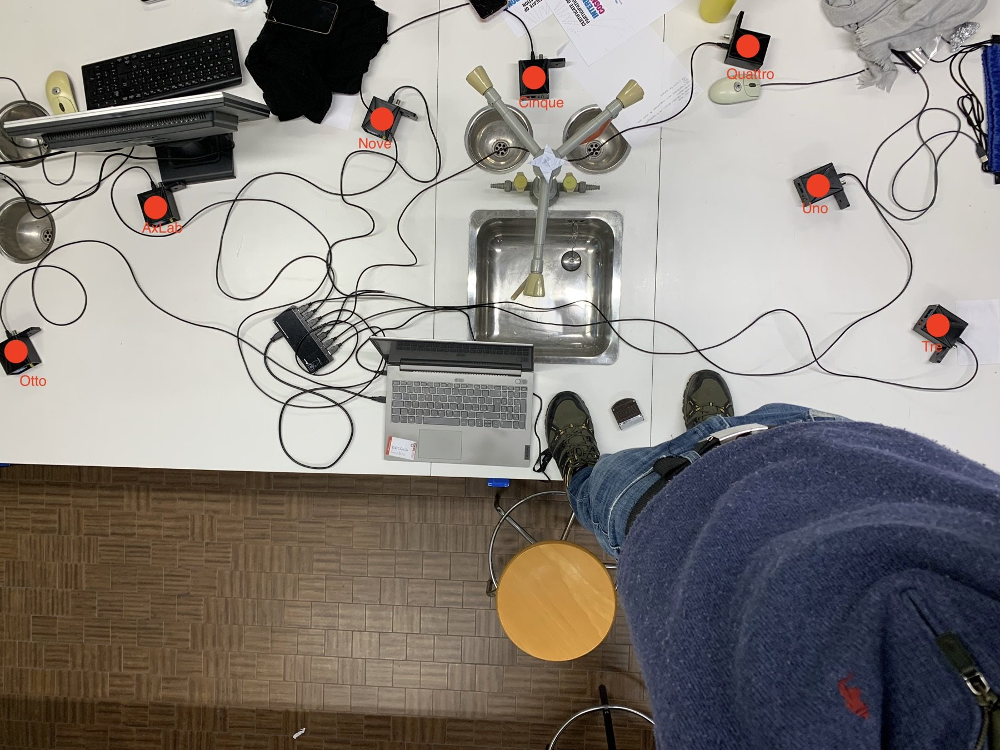
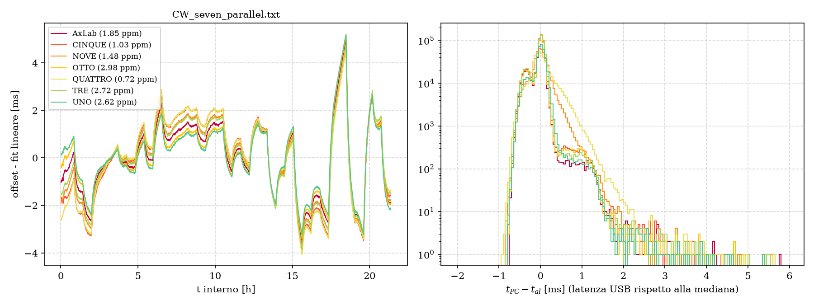
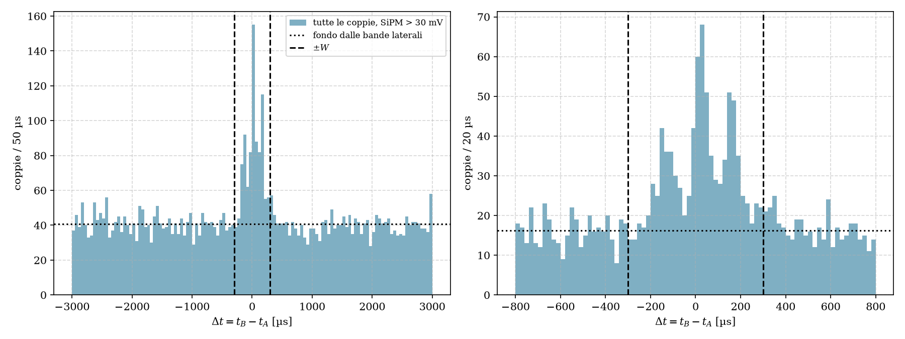
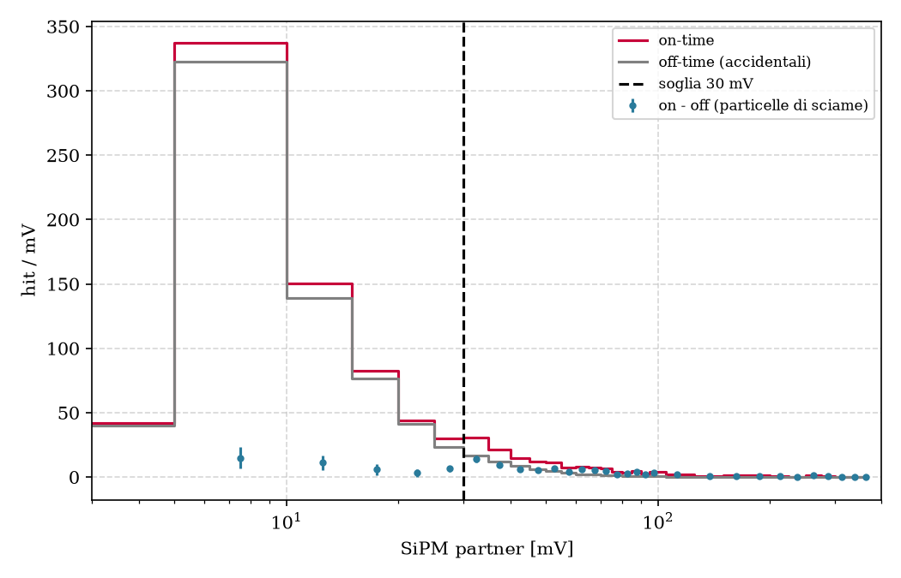
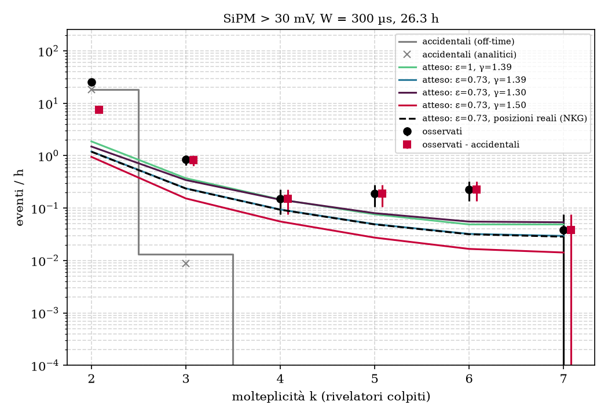
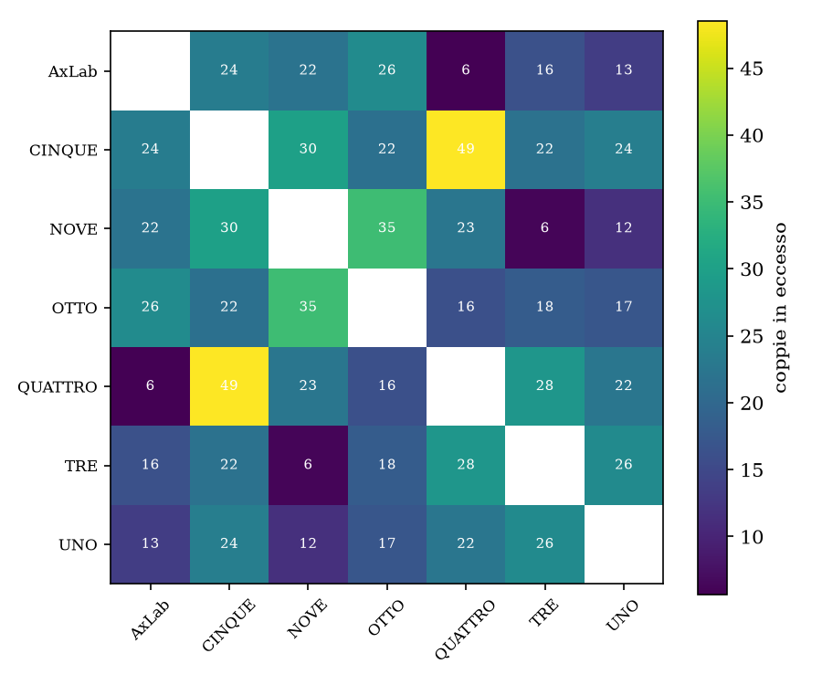
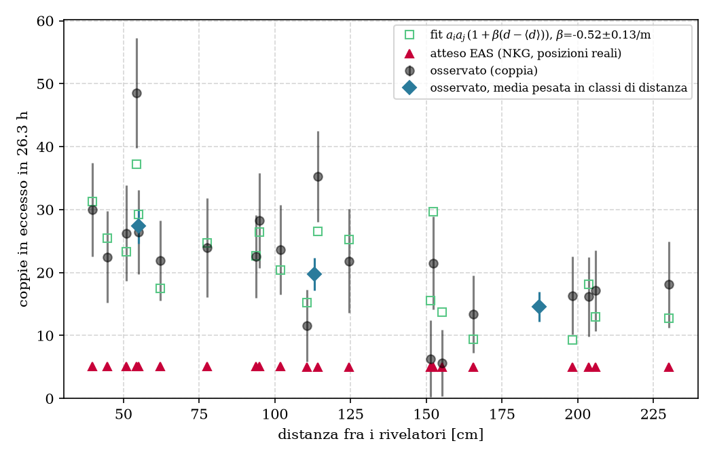

# Ricerca di sciami cosmici con 7 CosmicWatch affiancati

Analisi delle prese `CW_seven_parallel.txt` (13–14/11/2026, 21.4 h) e
`CW_seven_parallel_2.txt` (19/11/2026, 4.9 h): in totale **26.3 h** con 7
rivelatori sullo stesso tavolo, non impilati, letti insieme dal PC.

Codice: [`../shower_analysis.py`](../shower_analysis.py). Posizioni:
[`positions_IMG_6986.txt`](positions_IMG_6986.txt). Figure: [`Figures/`](Figures/).

```bash
cd Data
python shower_analysis.py showers_analysis/CW_seven_parallel.txt showers_analysis/CW_seven_parallel_2.txt \
    --positions showers_analysis/positions_IMG_6986.txt
```

Il programma impiega circa 30 s.

---

## In breve

- **Gli sciami si vedono senza ambiguità.** Ci sono 38 eventi con 3 o più
  rivelatori colpiti entro 300 µs, contro 0.35 attesi per caso. 16 eventi
  hanno 4 o più rivelatori, 1 li ha tutti e 7. Gli eventi sono distribuiti
  uniformemente nel tempo e hanno ampiezze da particella al minimo di
  ionizzazione (MIP) o da più particelle insieme.
- **L'ordine di grandezza è quello atteso**, ma i rate osservati sono più
  alti della previsione dalla letteratura: circa 3 volte per gli eventi a 3 o
  più rivelatori, circa 6 volte per le doppie.
- **Le doppie hanno una componente a corto raggio.** L'eccesso di coppie cala
  con la distanza fra i rivelatori: da 27 coppie (40–90 cm) a 15 coppie
  (150–230 cm), con una significatività di circa 3.6σ. Gli sciami estesi
  danno invece un andamento piatto su queste distanze. Questa componente è
  probabilmente fatta di sciami locali generati nei materiali dell'edificio.
- **Il resto è compatibile con gli sciami estesi.** Tolta la parte a corto
  raggio, i dati sono circa 3 volte la previsione. Il fattore è simile per
  le coppie lontane e per le triple, ed è compatibile con le incertezze sulla
  normalizzazione del modello.
- **Il punto tecnico decisivo è il timing.** Con il solo tempo del PC
  servirebbero finestre di alcuni ms, e gli accidentali coprirebbero tutto.
  Allineando i clock interni dei rivelatori al PC si scende a finestre di
  300 µs. A 3 o più rivelatori il fondo diventa così trascurabile.

---

## 1. Cosa si cerca

### 1.1 Sciami estesi in due parole

Un raggio cosmico primario (protone o nucleo) di alta energia urta un nucleo
dell'atmosfera a ~15–20 km di quota. Da quell'urto parte una cascata di
particelle secondarie, che si moltiplicano finché la loro energia lo permette.
A livello del suolo arriva un **disco sottile** di particelle che viaggiano
quasi alla velocità della luce: soprattutto elettroni, positroni e fotoni, più
alcuni muoni.

- **Spessore del fronte:** pochi ns vicino all'asse. Per noi le particelle
  arrivano **simultaneamente**: la nostra risoluzione è di ~100 µs, un milione
  di volte peggiore.
- **Estensione laterale:** la densità di particelle cala lentamente con la
  distanza r dall'asse dello sciame (il *core*). La scala tipica è il
  **raggio di Molière**, r_M ≈ 80 m al livello del mare. Il profilo usato di
  solito è la funzione NKG (Nishimura–Kamata–Greisen):

  ρ(r) ∝ N_e · (r/r_M)^(s−2) · (1 + r/r_M)^(s−4.5)

  dove N_e è il numero totale di particelle e s ≈ 1.3 è l'"età" dello
  sciame, un parametro di forma.
- **Cosa vede il nostro tavolo:** i rivelatori distano al massimo 2.3 m, molto
  meno di 80 m. Per quasi tutti gli sciami che ci colpiscono, la densità ρ è
  **praticamente la stessa su tutto il tavolo**. Ogni rivelatore pesca a caso
  dallo stesso "pioggia" di particelle.

### 1.2 Quanto spesso arriva una data densità

Non serve conoscere energia e posizione di ogni sciame. Esiste una misura
diretta e classica, lo **spettro di densità**: quante volte all'ora, in un
punto fissato del suolo, la densità di particelle cariche supera un valore ρ.
Al livello del mare vale

  **N(>ρ) = K · ρ^(−γ)**, con **K ≈ 540 h⁻¹** e **γ ≈ 1.39** (ρ in particelle/m²)

- **K** è la scala: circa 540 volte all'ora la densità in un punto supera
  1 particella/m².
- **γ** è la pendenza: una densità 10 volte maggiore è 10^1.39 ≈ 25 volte
  più rara.

Il valore γ ≈ 1.4 si ritrova anche nello spettro in dimensione degli sciami
(N_e) e, tramite questo, nello spettro in energia dei primari. Sopra
~1000 particelle/m² lo spettro diventa più ripido (γ → 2). Nel codice ne tengo
conto, ma pesa poco.

### 1.3 Dalla densità al numero di rivelatori colpiti

Un CosmicWatch ha uno scintillatore di area A = 5×5 cm² = 25 cm²
(= 0.0025 m², valore assunto). Se la densità locale è ρ, il numero di
particelle che lo attraversano segue una distribuzione di Poisson con media
ε·ρ·A. Qui ε è l'efficienza: la probabilità che una particella produca un
segnale sopra la soglia di analisi. La probabilità che il rivelatore sia
colpito è quindi

  p(ρ) = 1 − exp(−ε ρ A)

Con 7 rivelatori indipendenti alla stessa densità, la probabilità che
**esattamente k** siano colpiti è binomiale:

  P_k(ρ) = C(7,k) · p^k · (1−p)^(7−k)

Il rate atteso di eventi a molteplicità k si ottiene sommando su tutte le
densità, ciascuna pesata per la sua frequenza:

  R_k = ∫ P_k(ρ) · |dN/dρ| dρ = K · (εA)^γ · [un numero che dipende solo da γ e k]

Tre conseguenze utili:

1. **K** fissa solo la scala: tutti gli R_k sono proporzionali a K.
2. **γ** fissa la forma: i **rapporti R₃/R₂, R₄/R₂, …** non dipendono da K.
   Sono quindi un test del modello indipendente dalla normalizzazione, che è
   la parte più incerta (è il metodo usato anche dal progetto CREDO).
3. Il rate cresce come A^γ: raddoppiando l'area dei rivelatori crescerebbe di
   2^1.39 ≈ 2.6.

**Quali sciami contano.** Per colpire due rivelatori da 25 cm² serve
ρ·A ~ 1, cioè ρ ~ 400 particelle/m². La distanza tipica del core da cui
arrivano queste densità è di ~10–20 m. A quella distanza la densità varia di
pochi % su 2.3 m, e per questo la geometria del tavolo conta poco (sez. 6).
Corrisponde a sciami con N_e ~ 10⁵–10⁷ particelle, cioè primari di
~10¹⁴–10¹⁶ eV (stima di ordine di grandezza).

### 1.4 Ordini di grandezza

- **Muoni singoli:** ~1 per cm² al minuto, cioè ~0.4 Hz su 25 cm².
- **Rate dei singoli osservato:** 5.5–7.9 Hz per rivelatore. È dominato da
  impulsi piccoli (radioattività ambientale, rumore). Sopra 30 mV il rate
  scende a 0.5–0.8 Hz, vicino a quello dei muoni.
- **Coincidenze da sciame attese:** ~1.2 eventi/h a 2 rivelatori e ~0.4/h a
  3 o più (sez. 5). Sono **decine di migliaia di volte meno** dei singoli. Il
  problema è tutto separarle dalle coincidenze casuali.

---

## 2. I dati



*Figura 1. Il setup visto dall'alto. I punti rossi sono i 7 CosmicWatch, con i
loro nomi. Sono appoggiati sullo stesso piano, non impilati, e collegati via
USB a un hub e al portatile in basso, che registra tutti i dati. Le distanze
massime sono 230 cm in orizzontale (OTTO–TRE) e 90 cm in verticale
(OTTO–QUATTRO). Le posizioni ricavate da questa foto sono nella sez. 6.1.*

Ogni rivelatore manda via USB una riga per evento. `import_data.py` aggiunge
il nome del rivelatore e l'**ora del PC**, presa all'arrivo del primo byte
della riga.

| rivelatore | eventi | rate [Hz] | rate > 30 mV [Hz] | tempo morto | sincronizzazione [µs] |
|---|---|---|---|---|---|
| AxLab   | 646 212 | 6.83 | 0.52 | 0.53 % | 6 |
| CINQUE  | 722 614 | 7.64 | 0.82 | 0.65 % | 6 |
| NOVE    | 591 976 | 6.26 | 0.50 | 0.53 % | 11 |
| OTTO    | 659 052 | 6.96 | 0.60 | 0.59 % | 7 |
| QUATTRO | 611 920 | 6.47 | 0.63 | 0.55 % | 14 |
| TRE     | 746 157 | 7.88 | 0.77 | 0.66 % | 7 |
| UNO     | 517 639 | 5.47 | 0.63 | 0.47 % | 9 |

Note:

- **Nessun evento perso:** i numeri di evento sono consecutivi e non ci sono
  buchi oltre ~2 s.
- **Firmware originale.** Il tempo morto di ~0.85 ms per evento lo conferma
  (il confronto `Firmware/CosmicWatchOpen/confronto_fw` dà 870 µs per
  l'originale, 13 µs per il firmware open). Il flag di coincidenza hardware è
  sempre 0: i rivelatori non erano collegati fra loro.
- **Saturazione:** l'ADC satura a ~3650 LSB, cioè ~275–300 nella colonna
  `SiPM[mV]` di questo firmware.
- **Effetto del tempo morto:** ~0.6 % per rivelatore, quindi ≲ 4 % sulle
  coincidenze multiple. È trascurabile rispetto agli altri errori.

---

## 3. Il problema del tempo e come l'ho risolto

Ogni evento ha due tempi:

- **`Timestamp[s]`**, il clock interno del rivelatore, con risoluzione 1 µs.
  Ogni rivelatore ha però il suo quarzo: parte da zero all'accensione e va
  leggermente più veloce o più lento degli altri (1–3 ppm, cioè 1–3 ms
  all'ora).
- **`Time`**, l'ora del PC, comune a tutti. È però presa all'arrivo della riga
  su USB, con una latenza variabile di ~0.5–1 ms e code fino a qualche ms.

Con il solo tempo del PC servirebbero finestre di coincidenza di ~5 ms. Con
7 rivelatori a ~7 Hz il fondo casuale sarebbe enorme (sez. 4).

### 3.1 Allineamento dei clock

Per ogni rivelatore, in intervalli di 30 s:

1. calcolo la **mediana** di (t_PC − t_interno) sui ~200 eventi
   dell'intervallo;
2. interpolo queste mediane nel tempo;
3. costruisco il tempo allineato t_al = t_interno + offset(t_interno).

La mediana su ~200 eventi riduce il jitter USB (~1 ms) a pochi µs. La parte
di latenza uguale per tutti i rivelatori si cancella nelle differenze.

**Precisione.** La stimo rifacendo la stessa procedura separatamente sugli
eventi pari e su quelli dispari: risulta **6–14 µs**, a seconda del
rivelatore.

### 3.2 Cosa mostra la figura dell'allineamento



*Figura 2. Allineamento dei clock interni al tempo del PC (prima presa, 21.4 h).
**Sinistra:** per ogni rivelatore, l'offset t_PC − t_interno (mediana in
intervalli di 30 s) meno un fit lineare. In legenda la pendenza del fit, cioè
la differenza di frequenza fra quarzo e PC, in ppm. Le curve si muovono
insieme (orologio del PC, corretto da NTP) e si separano lentamente fra loro
(quarzi diversi). **Destra:** per ogni evento, di quanto la riga arriva al PC
prima o dopo la mediana del suo intervallo, cioè il jitter della catena
USB/PC. Scala verticale logaritmica.*

**A sinistra:** l'offset di ogni rivelatore meno un fit lineare.
- Le 7 curve si muovono **insieme** di ±4 ms, con cambi di pendenza netti.
  Sette quarzi indipendenti non possono farlo: è l'orologio del PC, corretto
  di continuo da NTP. Si cancella nelle coincidenze.
- La **separazione** fra le curve (fino a 2–3 ms, su scale di ore) è la
  differenza reale fra i quarzi, probabilmente legata alla temperatura. È ciò
  che l'allineamento deve seguire. Un solo fit lineare per rivelatore
  lascerebbe errori di ms.

**A destra:** la latenza USB evento per evento. Il nucleo è largo ~±0.5 ms,
con una coda fino a ~6 ms. NOVE e QUATTRO hanno code un po' più larghe.

### 3.3 Larghezza del picco di coincidenza e scelta della finestra



*Figura 3. Differenze di tempo Δt = t_B − t_A, con i tempi allineati, per
tutte le coppie di hit di rivelatori diversi sopra 30 mV, sommate sulle 21
coppie di rivelatori. **Sinistra:** ±3 ms, bin da 50 µs. **Destra:** zoom a
±800 µs, bin da 20 µs. Linea punteggiata: livello del fondo casuale, stimato
fra 1 e 3 ms. Linee tratteggiate: la finestra ±W = ±300 µs. Il picco sopra il
fondo sono le coincidenze vere. La sua struttura (picco centrale e lobi a
±170 µs) viene dal jitter del timestamp del firmware originale.*

La distribuzione delle differenze di tempo Δt fra hit di rivelatori diversi,
con soglia 30 mV, ha:

- **Fondo:** piatto, dovuto alle coincidenze casuali.
- **Picco:** a Δt = 0, ben visibile sopra il fondo, largo **~±250 µs**. Ha un
  picco centrale e due lobi a ±170 µs.

Questa larghezza non viene dall'allineamento, che è preciso a ~10 µs. Viene
dal **jitter del timestamp nel firmware originale**, dove il timestamp non è
preso esattamente all'istante del trigger. Il firmware open lo prende entro
~0.3 µs dal trigger con un core dedicato, e il picco dovrebbe stringersi a
~10–20 µs.

Ho quindi scelto **W = 300 µs** come span massimo di un gruppo di hit
(max t − min t ≤ W). È una scelta guidata dalla forma del picco. Non introduce
distorsioni nell'eccesso, perché il fondo è stimato in modo indipendente
(sez. 4).

**Controllo di stabilità:** cambiando gli intervalli di allineamento da 5 s a
120 s, l'eccesso nel picco resta lo stesso entro la statistica.

---

## 4. Coincidenze casuali (accidentali)

Due rivelatori indipendenti con rate R₁ e R₂ danno per puro caso hit entro
±W con rate

  R_acc(2) = 2 · R₁ · R₂ · W

Per k rivelatori, con span ≤ W, la formula generale (già usata in `plot.py`) è

  R_acc(k) = k · W^(k−1) · ∏ R_i , sommata su tutte le combinazioni di k rivelatori

Ogni rivelatore in più moltiplica per R·W ~ 0.6 Hz × 300 µs ≈ 2·10⁻⁴. Per
questo **gli accidentali crollano con la molteplicità**.

L'ho stimato in due modi:

1. **Analitico**, con la formula sopra e i rate misurati.
2. **Off-time**: sposto i tempi di ogni rivelatore di ritardi diversi, di
   decine di ms (molto più di W), e rifaccio la ricerca. Le coincidenze vere
   spariscono, quelle casuali restano. Questo metodo include automaticamente
   le variazioni dei rate nel tempo. Media su 20 diversi sfasamenti.

I due metodi sono in accordo (k=2: 477 contro 483).

### 4.1 Risultato in funzione della soglia (W = 300 µs, 26.3 h)

| soglia | k=2 oss / acc | k=3 oss / acc | k=4 oss / acc | k=5 oss / acc |
|---|---|---|---|---|
| 0 mV  | 54 587 / 53 775 | 360 / 272 | 12 / 0.8 | 8 / 0.0 |
| 15 mV | 5 071 / 4 632 | 43 / 6.8 | 4 / 0.0 | 8 / 0.0 |
| 20 mV | 2 212 / 1 852 | 28 / 1.6 | 3 / 0.0 | 8 / 0.0 |
| **30 mV** | **673 / 477** | **22 / 0.35** | **4 / 0.0** | **5 / 0.0** |
| 40 mV | 248 / 148 | 9 / 0.0 | 4 / 0.0 | 6 / 0.0 |
| 50 mV | 116 / 54 | 6 / 0.0 | 2 / 0.0 | 6 / 0.0 |
| 75 mV | 24 / 8 | 5 / 0.0 | 2 / 0.0 | 1 / 0.0 |

- **Senza soglia:** le doppie sono sommerse (eccesso ~1.5 % del fondo). Gli
  impulsi piccoli sono radioattività e rumore.
- **30 mV** è il compromesso scelto. Tiene il **73 %** delle particelle di
  sciame (sez. 4.2) e riduce il rate dei singoli di ~10 volte, e quindi gli
  accidentali doppi di ~100 volte.
- **k=2:** rapporto segnale/fondo ≈ 0.4. L'eccesso c'è, ma va estratto
  sottraendo il fondo.
- **k≥3:** rapporto segnale/fondo ≈ 60. È praticamente un campione puro.
- **Senza l'allineamento dei clock** (finestra ~5 ms) gli accidentali
  sarebbero ~17 volte di più per k=2 e ~280 volte di più per k=3: ~8000 doppie
  e ~100 triple casuali. Non si vedrebbe nulla.

### 4.2 Che segnale lasciano le particelle di sciame

Ho preso gli hit sopra 50 mV in un rivelatore (un "tag" pulito) e ho
guardato l'ampiezza degli hit negli altri rivelatori entro W, sottraendo la
stessa distribuzione presa fuori tempo. Lo spettro risultante:

- **forma:** larga e decrescente, da ~10 mV fino alla saturazione (~300 mV),
  senza un picco netto. La statistica è limitata (~800 hit) e le ampiezze
  grandi vengono da più particelle nello stesso rivelatore;
- **frazione sopra 30 mV:** 73 %. È l'efficienza ε usata nel modello. Gli
  hit casuali, invece, stanno quasi tutti sotto 30 mV.

È probabilmente una sovrastima per la singola particella, perché chiedere un
tag sopra 50 mV favorisce sciami più densi.



*Figura 4. Ampiezza (SiPM, mV) degli hit in coincidenza (|Δt| ≤ 300 µs) con un
hit sopra 50 mV in un altro rivelatore, per tutti gli hit, senza soglia.
Asse x logaritmico, conteggi per mV (i bin sono larghi 5 mV sotto 100 mV e
25 mV sopra). **Rosso:** hit trovati in tempo. **Grigio:** stessa ricerca con
il tag spostato di ±13.7, 27.4, … ms, cioè solo coincidenze casuali.
**Punti blu:** differenza fra i due, cioè lo spettro delle particelle di
sciame. Sotto 30 mV (linea tratteggiata) dominano i casuali, dovuti a
radioattività e rumore. L'eccesso vero sta per il 73 % sopra soglia.*

---

## 5. Risultati e confronto con il modello

### 5.1 Molteplicità

Soglia 30 mV, W = 300 µs, 26.3 h. L'eccesso è la differenza fra osservati e
accidentali off-time.

| k | osservati | accidentali | eccesso | eccesso [1/h] | atteso [1/h] (ε=0.73, γ=1.39) | oss/atteso |
|---|---|---|---|---|---|---|
| 2 | 673 | 477 | 196 ± 26 | 7.45 ± 1.00 | 1.19 | 6.3 |
| 3 | 22 | 0.35 | 21.6 ± 4.7 | 0.82 ± 0.18 | 0.24 | 3.5 |
| 4 | 4 | 0 | 4 ± 2 | 0.15 ± 0.08 | 0.093 | 1.6 |
| 5 | 5 | 0 | 5 ± 2.2 | 0.19 ± 0.09 | 0.049 | 3.9 |
| 6 | 6 | 0 | 6 ± 2.4 | 0.23 ± 0.09 | 0.032 | 7.2 |
| 7 | 1 | 0 | 1 ± 1 | 0.04 ± 0.04 | 0.029 | 1.3 |
| **≥3** | **38** | **0.35** | **37.6** | **1.43 ± 0.24** | **0.44** | **3.3** |



*Figura 5. Rate di eventi (per ora, scala logaritmica) in funzione del numero
k di rivelatori colpiti entro 300 µs, con soglia 30 mV.
**Cerchi neri:** tutti gli eventi osservati. **Quadrati rossi:** osservati meno
accidentali, cioè gli eventi da sciame.
**Grigio:** accidentali, con il metodo off-time (linea) e la formula analitica
(croci). Valgono ~18/h per k=2, ~0.01/h per k=3 e sono fuori scala per k≥4.
**Linee colorate:** attese dallo spettro di densità per diverse ipotesi su ε
e γ. **Tratteggio nero:** il Monte Carlo con le posizioni reali, praticamente
sovrapposto al caso ε=0.73, γ=1.39. Gli osservati stanno sopra le attese di un
fattore ~3 (~6 per k=2), ma seguono lo stesso andamento con k.*

Variando le ipotesi l'atteso per k≥3
va da ~0.27/h (γ=1.5) a ~0.69/h (ε=1 oppure γ=1.3). Il disaccordo resta
quindi un fattore **2–5**.

**Rapporti indipendenti da K:**

| | osservato | atteso (γ = 1.30 / 1.39 / 1.50) |
|---|---|---|
| R₃/R₂ | 0.11 ± 0.03 | 0.23 / 0.20 / 0.16 |
| R₄/R₂ | 0.020 ± 0.011 | 0.10 / 0.08 / 0.06 |

Le doppie sono in eccesso più delle multiple. È il primo indizio che nelle
doppie c'è qualcosa in più degli sciami estesi.

### 5.2 Gli eventi sembrano sciami?

Sì, per quattro motivi:

- **Span:** compreso fra 50 e 290 µs, compatibile con la risoluzione.
- **Ampiezze:** negli eventi a k alto sono spesso ben sopra un MIP e a volte
  in saturazione in tutti i rivelatori, come atteso con molte particelle per
  rivelatore. Esempi:
  - 13/11 19:17:36, **k=7**: CINQUE 178, OTTO 280, AxLab 267, TRE 60,
    UNO 234, QUATTRO 160, NOVE 221;
  - 14/11 10:29:46, k=5: tutti a 270–300, in saturazione.
- **Distribuzione nel tempo:** uniforme (test di Kolmogorov-Smirnov sui 38
  eventi k≥3: p = 0.82). Non ci sono burst, che invece ci si aspetterebbe da
  disturbi elettrici.
- **Coppie:** l'eccesso c'è in tutte le 21 coppie di rivelatori.

### 5.3 Molteplicità 6 e 7

Sono gli eventi più puliti: gli accidentali valgono ~10⁻¹² eventi per k=6 e
~10⁻¹⁷ per k=7 in 26.3 h. Anche una coincidenza vera a k=5 più un hit casuale
in un sesto rivelatore pesa ~10⁻⁴ eventi. **Ogni evento con 6 o 7 rivelatori
è uno sciame vero.**

| ipotesi | atteso k=6 | atteso k=7 | atteso k≥6 | P(≥7 eventi) | con fattore ×3 | P(≥7), con ×3 |
|---|---|---|---|---|---|---|
| ε=0.73, γ=1.39 | 0.83 | 0.75 | 1.6 | 0.001 | 4.8 | 0.20 |
| ε=0.73, γ=1.30 | 1.45 | 1.41 | 2.9 | 0.03 | 8.6 | 0.75 |
| ε=0.73, γ=1.50 | 0.44 | 0.37 | 0.8 | 2·10⁻⁵ | 2.4 | 0.01 |
| ε=1, γ=1.39 | 1.28 | 1.28 | 2.6 | 0.016 | 7.7 | 0.65 |

Osservati: **6 eventi a k=6 e 1 a k=7, in totale 7** contro ~1.6 attesi. La
colonna "con fattore ×3" applica il fattore comune di normalizzazione trovato
per le coppie lontane e per k≥3 (sez. 7).

- **Con la normalizzazione di letteratura** il numero è troppo alto (p ≈ 10⁻³
  per i valori centrali).
- **Con il fattore ×3** diventa compatibile: 7 osservati contro ~5 attesi,
  p ≈ 0.2.
- **La forma è giusta.** Il modello prevede k=6 e k=7 quasi alla pari, perché
  uno sciame abbastanza denso da colpirne 6 spesso li colpisce tutti. Nei dati
  sono 6 e 1: una fluttuazione di ~1.5–2σ con questa statistica.
- **Questi eventi confermano il fattore ×3.** La componente locale a corto
  raggio difficilmente colpisce 6 rivelatori sparsi su 2.3 m, quindi qui conta
  quasi solo la componente da sciami estesi. Se il fattore ×3 fosse dovuto
  alla componente locale, qui l'eccesso sparirebbe; invece si ritrova lo
  stesso fattore.

---

## 6. Il ruolo delle posizioni

### 6.1 Posizioni

Le posizioni vengono dalla foto `IMG_6986.HEIC`: centri dei punti rossi, con
scale fissate da 230 cm in orizzontale (OTTO–TRE) e 90 cm in verticale
(OTTO–QUATTRO).

| | OTTO | AxLab | NOVE | CINQUE | QUATTRO | UNO | TRE |
|---|---|---|---|---|---|---|---|
| x [cm] | 0 | 35 | 91 | 129 | 183 | 200 | 230 |
| y [cm] | 0 | 43 | 69 | 81 | 90 | 49 | 8 |

Le distanze fra le coppie vanno da 40 a 230 cm. Le scale dei due assi
differiscono del 18 % per la prospettiva, quindi l'incertezza è di qualche cm.

### 6.2 Modello con geometria reale

Ho scritto un Monte Carlo che usa le posizioni vere:

1. estrae la densità al centro del tavolo dallo stesso spettro N(>ρ);
2. estrae la distanza del core secondo la sua distribuzione: a parità di
   densità al centro, un core lontano richiede uno sciame più grande, e gli
   sciami grandi sono più rari;
3. calcola la densità in ogni rivelatore con il profilo NKG;
4. calcola esattamente le probabilità di molteplicità.

**Verifica:** imponendo densità uniforme il Monte Carlo riproduce il calcolo
analitico entro lo 0.5 %.

**Risultato:** con le posizioni reali gli attesi calano solo dello **0.7–3 %**
(per k=2: 1.190/h contro 1.199/h). Il rate per coppia previsto dagli sciami
estesi è ~5.0 coppie in 26.3 h, con una variazione del 2 % fra 40 e 230 cm. Su
un tavolo di 2 m **gli sciami estesi non sanno quanto sono distanti i
rivelatori**. L'approssimazione di densità uniforme era quindi corretta, e il
disaccordo della sez. 5.1 non dipende dalla geometria.

### 6.3 Coppie in funzione della distanza

L'"eccesso per coppia" conta, per ogni coppia, quante coppie di hit cadono
entro W oltre al fondo. Include anche le coppie che fanno parte di eventi a
k≥3.



*Figura 6. Eccesso di coppie in coincidenza (|Δt| ≤ 300 µs, sopra 30 mV, fondo
sottratto) per ciascuna delle 21 coppie di rivelatori, in 26.3 h. La matrice è
simmetrica. L'errore su ogni valore è ~±6–9. Gli sciami estesi da soli
darebbero ~5 per ogni coppia. I valori più alti (CINQUE–QUATTRO 49,
NOVE–OTTO 35) e più bassi (AxLab–QUATTRO 6, NOVE–TRE 6) suggeriscono una
struttura, analizzata nella Figura 7.*

**Primo controllo, senza posizioni.** L'eccesso non è uguale per tutte le
coppie (χ²/ndf = 37.4/20, p = 0.01). Un modello a_i·a_j, dove ogni rivelatore
ha la sua efficienza (i guadagni sono un po' diversi), migliora ma non basta
(χ²/ndf = 26.8/14, p = 0.02).

**Con le posizioni.** Il modello è y_ij = a_i·a_j·(1 + β·(d_ij − 1.18 m)):
efficienze individuali più una dipendenza lineare dalla distanza, fittate
insieme.

- **β = −0.52 ± 0.13 per metro** (gli sciami estesi darebbero ≈ −0.01 per
  metro).
- Aggiungere β migliora il fit di Δχ² = 13 con un parametro in più (~3.6σ). Il
  fit diventa buono: χ²/ndf = 13.8/13.
- **Test a permutazioni:** ho rifatto il fit per tutte le 5040 assegnazioni
  nome→posizione. Solo lo **0.4 %** dà una pendenza così negativa. Il test non
  dipende da come sono stimati gli errori.

| distanza | coppie | eccesso medio per coppia | atteso da sciami estesi | rapporto |
|---|---|---|---|---|
| 40–88 cm | 7 | 27.4 ± 2.8 | 5.0 | 5.5 |
| 88–152 cm | 7 | 19.8 ± 2.6 | 5.0 | 4.0 |
| 152–230 cm | 7 | 14.6 ± 2.4 | 5.0 | 2.9 |



*Figura 7. Eccesso di coppie in funzione della distanza fra i due rivelatori.
**Punti grigi con errore:** le 21 coppie. **Rombi blu:** media pesata in tre
classi di distanza (7 coppie ciascuna). **Quadrati verdi vuoti:** il fit con
efficienze individuali e una dipendenza lineare dalla distanza
(β = −0.52 ± 0.13 per metro). **Triangoli rossi:** l'attesa degli sciami
estesi con le posizioni reali, ~5 coppie e piatta con la distanza. Le coppie
vicine hanno un eccesso ~2 volte quello delle coppie lontane: è la componente
a corto raggio discussa nella sez. 7.*

---

## 7. Interpretazione

L'eccesso rispetto al modello si separa in due parti.

**1. Una componente a corto raggio**, su scala di ~1–2 m. Gli sciami estesi
non possono produrla, perché a queste distanze la loro densità è uniforme. È
lei a gonfiare le doppie: spiega il fattore ~6 per k=2 e il valore basso di
R₃/R₂.

Il candidato più naturale sono gli **sciami locali**. Una particella
energetica dello sciame, oppure un adrone o un muone isolato, interagisce nei
materiali sopra il tavolo (solai, tetto, struttura del laboratorio) e produce
una piccola cascata di pochi metri. Due rivelatori vicini ne vengono colpiti
spesso insieme, due lontani molto meno. È un effetto noto fin dalle prime
misure con contatori sotto materiale.

Spiegazioni alternative meno probabili:
- **correlazioni elettriche fra rivelatori vicini:** vanno contro la soglia a
  30 mV, lo spettro dei partner, che sta per il 73 % sopra soglia mentre il
  rumore sta sotto, e l'assenza di burst nel tempo;
- **un singolo muone molto inclinato che attraversa due rivelatori vicini:**
  il flusso a grande angolo è troppo piccolo, e le scatole sono distanti
  almeno 40 cm.

**2. Una componente che resta anche a distanza**, circa 3 volte la
previsione. Le coppie lontane valgono ~2.9 volte l'atteso e le triple ~3.3
volte: un fattore simile, compatibile con una correzione comune alla
normalizzazione.

- **K** viene da misure con contatori Geiger o proporzionali, che contano solo
  particelle cariche, all'aperto, ed è incerta di decine di %.
- **Uno scintillatore plastico vede anche una parte dei fotoni** dello
  sciame, che sono più numerosi degli elettroni. La densità efficace è quindi
  maggiore di quella delle sole cariche.
- **I materiali sopra il tavolo** cambiano la composizione dello sciame
  (effetto di transizione), aumentando il numero di particelle cariche.
- **La forma dello spettro** fra 100 e 1000 particelle/m² è proprio la zona
  in cui la letteratura inizia a vedere l'irripidimento.

**Conclusione.** I dati sono **consistenti con sciami estesi più una
componente locale**. La parte da sciami estesi ha la forma attesa (andamento
con k, indipendenza dalla distanza) e un rate ~3 volte sopra la
normalizzazione di letteratura. Il fattore è plausibile date le differenze fra
i nostri rivelatori e quelli con cui quella normalizzazione è stata misurata.
Gli accidentali sono sotto controllo per tutte le molteplicità: sottratti per
k=2, trascurabili per k≥3.

---

## 8. Limiti

- **Area e geometria dei rivelatori:** l'area di 25 cm² è assunta. Ho
  ignorato l'inclinazione degli sciami (attorno allo zenit sono più
  frequenti).
- **Efficienza ε = 0.73:** stimata dai dati, probabilmente un po' alta. Una ε
  più bassa abbasserebbe gli attesi e allargherebbe il disaccordo.
- **Normalizzazione K = 540 h⁻¹:** riportata in un abstract di una misura con
  contatori proporzionali, in accordo con i vecchi risultati Geiger. Non ho
  controllato l'articolo originale.
- **Dipendenza dalla distanza:** il modello lineare è solo empirico. Non è
  fisico oltre ~3 m. Con 21 coppie non si possono distinguere forme diverse,
  per esempio un termine costante più un esponenziale.
- **Statistica per k≥4:** piccola (16 eventi). Le differenze fra k=4, 5 e 6
  non sono significative.

---

## 9. Prossimi passi

1. **Rivelatori più distanti** (5–10 m, tavoli o stanze diverse). La
   componente degli sciami estesi resterebbe quasi uguale, mentre quella
   locale dovrebbe sparire. È il test più diretto.
2. **Firmware open**, con il timestamp a 1 µs preso al trigger. Il picco di
   coincidenza dovrebbe stringersi da ~250 µs a ~10–20 µs. Gli accidentali
   doppi calerebbero di ~15 volte, permettendo di abbassare la soglia e
   recuperare efficienza. Attenzione: con questo firmware la coda della
   latenza USB è più lunga (99° percentile 2.7 ms contro 0.5 ms), ma
   l'allineamento con la mediana non ne risente.
3. **Prese più lunghe** per avere statistica a k≥4. Il rapporto R₄/R₂, a
   rivelatori distanti, misura γ indipendentemente da K.
4. **Correlazione con la pressione:** il rate degli sciami cala di ~1 % per
   ogni hPa in più (assorbimento in atmosfera), e la pressione è già nei
   dati.

---

## Appendice: opzioni dello script

| opzione | default | significato |
|---|---|---|
| `-t/--threshold-mv` | 30 | soglia SiPM per gli hit nelle coincidenze |
| `-w/--window-us` | 300 | span massimo W di un gruppo |
| `--align-bin-s` | 30 | ampiezza degli intervalli per l'allineamento dei clock |
| `--n-shifts` | 20 | numero di sfasamenti per gli accidentali off-time |
| `--tag-mv` | 50 | soglia del tag per lo spettro delle particelle di sciame |
| `--area-cm2` | 25 | area di un rivelatore |
| `--K`, `--gamma` | 540, 1.39 | spettro di densità N(>ρ) = K ρ^−γ |
| `--positions` | — | file `nome x_cm y_cm` per il modello geometrico e le coppie |
| `--nkg-age`, `--moliere-m` | 1.3, 80 | profilo laterale NKG |
| `--show` | — | mostra le figure, oltre a salvarle |

Figure prodotte in `Figures/`, ognuna in PDF e in PNG (il PNG è quello incluso
in questo documento). La foto `IMG_6986.jpg` è una copia ridotta di
`IMG_6986.HEIC`:

- `shower_clock_alignment`: allineamento dei clock e latenza USB;
- `shower_pair_dt`: Δt fra coppie, picco e fondo;
- `shower_pair_excess`: matrice degli eccessi per coppia;
- `shower_partner_spectrum`: spettro d'ampiezza delle particelle di sciame;
- `shower_multiplicity`: molteplicità osservata, accidentali e attese;
- `shower_pair_vs_distance`: eccesso per coppia contro distanza.

### Riferimenti

- Spettro di densità al livello del mare, N(>ρ) ≈ 540 ρ^−1.39 h⁻¹: misure con
  contatori proporzionali e Geiger, citate in
  [Zawadzki, Wibig, Gawin, *On the EAS density spectrum*](https://arxiv.org/html/hep-ph/9807535).
- Rapporti di molteplicità come test indipendente dalla normalizzazione:
  [CREDO, *The first CREDO registration of extensive air shower*](https://iopscience.iop.org/article/10.1088/1361-6552/ab9dbc).
- Storia degli sciami estesi e dello spettro di densità:
  [Kampert & Watson, *Extensive Air Showers and UHECR: a historical review*](https://arxiv.org/pdf/1207.4827).
- Irripidimento dello spettro di densità sopra ~1000 m⁻²:
  [Durham thesis, *Study of EAS at sea level*](https://etheses.durham.ac.uk/id/eprint/8204/).
