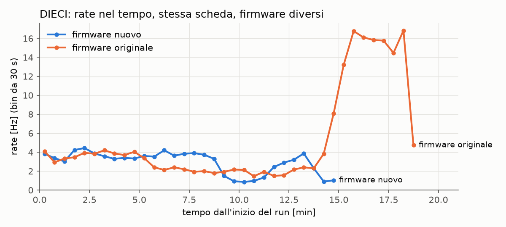
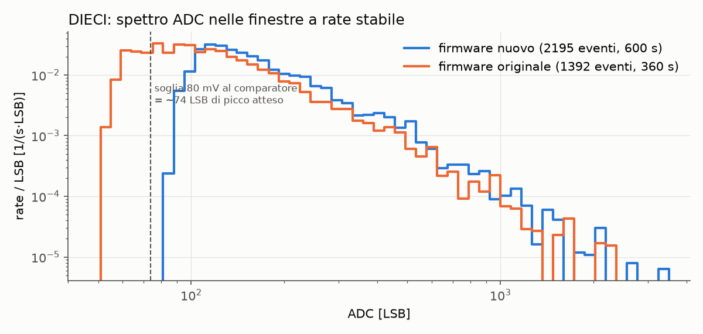

# Confronto firmware nuovo / originale su DIECI (12/10/2026)

## Sintesi

1. **Il firmware nuovo è compatibile con l'originale.** Formato dei dati, colonne
   e precisione dei numeri sono identici, così come l'andamento del clock. Il rate
   nei periodi in cui il detector era stabile coincide entro 1.6σ.
2. **Le differenze attese ci sono e sono nella direzione giusta:**
   - tempo morto: **13 µs** per evento contro 870 µs, cioè 0.005 % del tempo
     contro 0.28 %;
   - nessun evento perso;
   - soglia stabile.
3. **DIECI è instabile con entrambi i firmware.** Ci sono cali di rate fino a
   ~1–2 Hz e, con l'originale, un episodio a ~16 Hz. Il difetto è hardware, non
   del firmware. Il confronto del rate su questo detector è quindi limitato alle
   finestre stabili.
4. **Quattro differenze vanno spiegate prima di usare i dati insieme:**
   - **spettro ADC.** Il firmware originale legge ampiezze più basse, soprattutto
     vicino alla soglia, e registra valori **inferiori a quelli che la soglia stessa
     garantisce**. Il nuovo è coerente con la soglia. I dati in ADC o mV dei due
     firmware non vanno mescolati;
   - **HV letta:** 28.63 V con l'originale, 29.63 V con il nuovo, sulla stessa
     scheda. Va misurata con un multimetro;
   - **temperatura della scheda:** cresce di 0.12 °C/min con il nuovo, contro
     0.05 °C/min con l'originale. È probabile che il nuovo dissipi di più, perché i
     due core non vanno mai in attesa;
   - **IMU:** l'originale calibra accelerometro e giroscopio all'avvio, il nuovo
     scrive i valori grezzi.

## Dati e metodo

| | firmware nuovo (CosmicWatch-open 1.0.0) | firmware originale (v3X.28) |
|---|---|---|
| Orario | 11:33–11:48 | 11:56–12:11 (USB); file SD fino a 12:15 |
| Presa | USB, 900 s, `longcap.py` | USB 900 s, più il file SD `AxLab_M_009.txt` (1120 s) |
| File | `Data/fwcmp_DIECI_newfw_2026-10-12.txt` | `Data/fwcmp_DIECI_oldfw_2026-10-12.txt`, `Data/AxLab_M_009.txt` |
| Configurazione | soglia 80 mV, correzione in temperatura spenta | soglia 80 mV, **correzione in temperatura accesa** (default ricreato dall'originale) |
| Scheda | DIECI, nessun intervento fra i due run se non il cambio di firmware | uguale |

- **Tempo al PC:** viene registrato all'arrivo del primo byte di ogni riga, come in
  `import_data.py`.
- **Finestre stabili:** bin da 30 s con 90–150 conteggi (3–5 Hz). Sono 600 s per il
  nuovo e 360 s per l'originale.
- **Riferimento storico:** `Data/coincidence_nine.txt` e altri file presi con il
  firmware originale su altri detector.

## Risultati

### Formato e integrità

| controllo | nuovo | originale |
|---|---|---|
| Colonne su USB | 11 | 11 |
| Decimali (Timestamp, SiPM, Deadtime, Temp, Press) | 6, 1, 6, 1, 0 | 6, 1, 6, 1, 0 |
| Buchi nella numerazione / timestamp non monotoni | 0 / 0 | 0 / 0 |
| Valori sentinella (T = −5, P = 0) | 0 | 0 |
| Eventi persi (coda, USB, SD), trigger bloccati | 0 / 0 / 0, 0 (`status`) | non riportati |

### Tempo morto

| | nuovo | originale |
|---|---|---|
| Per evento (mediana) | **13 µs** | **870 µs** su USB, 663 µs nel file SD (periodo in parte senza USB) |
| 95° percentile | 76 µs (evento più campione di baseline) | 952 µs |
| Δt minimo osservato fra due eventi | 20 µs | 1025 µs |
| Frazione del tempo di run | 0.005 % | 0.28 % |

Il Δt minimo è coerente con il tempo morto dichiarato in entrambi i firmware: la
colonna `Deadtime[s]` è affidabile.

### Rate

| | nuovo | originale |
|---|---|---|
| Media sull'intero run | 2.94 ± 0.06 Hz | 3.16 ± 0.06 Hz |
| Nelle finestre stabili | **3.66 ± 0.08 Hz** | **3.87 ± 0.10 Hz** |
| χ²/ndf a rate costante (bin da 60 s) | 258/13 | 211/13 |

- **Finestre stabili:** la differenza è 0.21 ± 0.13 Hz, cioè 1.6σ, quindi i rate
  sono compatibili. La selezione delle finestre non è identica nei due run.
- **Instabilità:** riguarda entrambi i firmware ed è più forte con l'originale
  (episodio a ~16 Hz fra il minuto 15 e il 18). Con il firmware nuovo i cali sono
  stati analizzati in dettaglio:
  - nessuna correlazione con i cicli periodici del firmware (0.1, 1, 5 s);
  - soglia, HV e tempo morto invariati;
  - nessun movimento rilevato dall'IMU;
  - spettro compresso nella zona dei muoni e baseline più bassa e meno rumorosa,
    compatibili con un calo del guadagno del SiPM di circa il 35 %.

  L'HV misurata sulla scheda principale resta costante, quindi la causa più
  probabile è a valle: connettore della schedina SiPM, saldature, accoppiamento
  ottico. Lo stesso sintomo (~13 Hz con eventi a ridosso della soglia) era comparso
  quando la schedina "non era inserita bene".

### Spettro ADC (finestre stabili)

| quantile | nuovo | originale | (orig − 40)/(nuovo − 40) |
|---|---|---|---|
| 1 % | 94 | 59 | 0.35 |
| 10 % | 112 | 73 | 0.46 |
| 50 % | 170 | 129 | 0.68 |
| 90 % | 435 | 338 | 0.75 |
| 99 % | 1117 | 976 | 0.87 |

| rate sopra un taglio | nuovo | originale |
|---|---|---|
| ADC > 300 | 0.70 /s | 0.48 /s |
| ADC > 1000 | 0.052 /s | 0.031 /s |

**Interpretazione.**

*Fatto.* La soglia è di 80 mV sul segnale amplificato, e il peak detector legge
quello stesso segnale attraverso il partitore 1.3/2.3 con fondo scala di 2.5 V.
Quindi ogni evento che fa scattare il trigger ha un picco di almeno
`80 mV × 0.565 / 0.61 mV/LSB ≈ 74 LSB`, trascurando gli offset del peak detector.

| | ADC minimo | primo percentile | rispetto a 74 LSB |
|---|---|---|---|
| firmware nuovo | 85 | 94 | sopra, coerente |
| firmware originale | 54 | 59 | **sotto**, quindi l'originale non coglie il picco intero degli impulsi piccoli |

*Ipotesi.* La differenza viene dall'istante di lettura. Il nuovo campiona circa
3.1 µs dopo il trigger. L'originale campiona prima (il manuale indica 32 letture
da 72 ns, cioè ~2.3 µs, prima dell'ADC), mentre il peak detector sta ancora
salendo. La resistenza di retroazione R14 (100 kΩ), insieme alle capacità di
ingresso, dà una costante di tempo dell'ordine di 1 µs. Gli impulsi piccoli, con
meno sovrapilotaggio dell'amplificatore, si avvicinano al picco più lentamente,
e infatti il rapporto fra i due firmware va da 0.35 vicino alla soglia a 0.87
sui grandi.

*Conseguenze:*
- `SiPM[mV]` dei due firmware non è confrontabile in valore assoluto, a maggior
  ragione perché k = 0.0706 mV/LSB era stato ricavato dai dati dell'originale;
- la posizione del picco dei muoni (MPV) cambia di circa il 25–30 % fra un
  firmware e l'altro;
- il numero di eventi registrati invece non cambia, perché il trigger non dipende
  dall'ADC.

### Grandezze ausiliarie

| | nuovo | originale | note |
|---|---|---|---|
| HV (ADC2) | **29.63 V** (2101 LSB) | **28.63 V** (2031 LSB) | stessa scheda, stessa conversione LSB → V; da verificare con un multimetro (vedi sotto) |
| Fit della soglia | 1577 mV/duty | 1540 mV/duty | anche qui l'originale legge circa il 2.4 % in meno |
| Soglia misurata contro impostata | 79.6–80.2 contro 80.00 mV | 81.3 contro 80.00 mV (solo al boot) | |
| Baseline ADC0 | 41.5 ± 2.6 LSB | 34.6 ± 1.1 LSB | |
| Temperatura del BMP280 | 26.6 → 28.6 °C, **+0.12 °C/min** | 23.2 → 24.2 °C, **+0.05 °C/min** | scheda la stessa; vedi sotto |
| Pressione | 1002.2–1002.4 hPa | 1002.5–1002.8 hPa | coerenti |
| Accelerazione media | (0.014, 0.033, 0.784) g, \|a\| = 0.784 | (0.000, 0.001, 0.994) g | vedi sotto |
| Giroscopio medio | (−5.27, 2.63, −0.02) °/s | (−0.17, 0.16, 0.01) °/s | vedi sotto |
| Deriva del clock rispetto al PC | −2.9 ppm | −3.5 ppm | stesso quarzo, coerenti |
| Latenza al PC, 50/90/99 % | 0.27 / 0.39 / 2.7 ms | 0.26 / 0.38 / 0.49 ms | |

**HV.**
- *Fatto:* con il firmware originale TOP leggeva 2030.7 LSB (`TOP_C_002.txt`) e
  DIECI 2030.6–2031.6 LSB: due schede diverse con lo stesso valore al decimo di
  LSB, cosa improbabile per due booster con resistenze all'1 %.
- *Ipotesi:* l'originale lascia attivi i pull-down interni sui pin dell'ADC, che
  abbassano le letture di più sui nodi ad alta impedenza. Sarebbe coerente con il
  −2.4 % sulla soglia (ADC1, sorgente ~500 Ω) e con il −3.4 % sull'HV (ADC2,
  sorgente ~960 Ω).
- *Verifica:* misura con un multimetro l'HV sul connettore P1 e la tensione su
  TriggerThreshold. Il valore nominale è 30.2 V; il nuovo legge −1.9 %,
  l'originale −5.2 %.

**Temperatura.**
- Con il nuovo la scheda si scalda più del doppio più in fretta, pur partendo da
  una temperatura più alta, quindi già più vicina all'equilibrio.
- *Ipotesi:* entrambi i core del firmware nuovo girano senza mai fermarsi (il
  core 1 per la latenza minima, il core 0 per il ciclo principale), quindi il Pico
  consuma di più, e il BMP280 è vicino.
- *Da misurare:* l'assorbimento con un tester USB, nuovo contro originale.
- *Rimedio possibile:* mettere i core in attesa quando non c'è nulla da fare (il
  core 1 risvegliato dall'interrupt del PIO), senza costo apprezzabile in latenza.

**IMU.**
- Nei dati storici dell'originale, su 9 detector, x e y valgono 0.000 ± 0.004 g
  e il giroscopio ~0 °/s: offset impossibili da ottenere senza una calibrazione.
  Quindi l'originale sottrae gli offset all'avvio, assumendo il detector in piano.
- Il nuovo scrive i valori grezzi. Lo 0.784 g di DIECI è la lettura non calibrata
  del sensore, con un offset di circa −0.21 g sull'asse z, e non un errore di
  scala.
- I valori dell'IMU dei due firmware hanno quindi significato diverso.

## Valutazione di compatibilità

| aspetto | compatibile? | note |
|---|---|---|
| Formato dei file e del flusso USB, parser (`import_data.py`, GUI) | **sì** | identico |
| Conteggi e rate | **sì**, nei limiti della statistica e dell'instabilità di DIECI | va ripetuto su un detector stabile |
| Tempo morto | migliorato | 67 volte più basso; la colonna resta coerente con il Δt minimo |
| Clock e timestamp | **sì** | |
| Ampiezze (ADC, SiPM[mV]) | **no**, scale diverse | in ampiezza netta (ADC − baseline) il nuovo legge circa il 15 % in più sugli impulsi grandi e fino a quasi 3 volte tanto vicino alla soglia; non mescolare spettri dei due firmware |
| HV, soglia letta | **no**, letture diverse dell'ADC | da chiarire con un multimetro |
| T, P | **sì** | la T risente di un riscaldamento diverso della scheda |
| Accelerometro, giroscopio | **no**, significato diverso | originale calibrato all'avvio, nuovo grezzo |

## Azioni proposte

1. **Ripetere il confronto su un detector sano**, possibilmente con schema A/B/A
   (nuovo, originale, nuovo) e 30 minuti per run, per una misura del rate a meglio
   del 2 %.
2. **Misurare con un multimetro** l'HV su P1 e la tensione di soglia: dice quale
   firmware legge giusto.
3. **Scansione del ritardo di lettura dell'ADC** (`PIANO_MISURE.md`, §2.3) con
   impulsi iniettati dal BNC, per trovare il plateau del peak detector. Poi
   ricalibrare k (mV/LSB) all'oscilloscopio per il firmware nuovo.
4. **Misurare l'assorbimento** e valutare le attese a basso consumo sui due core.
5. **Opzione `IMU_CALIBRATE_AT_BOOT`** nel firmware nuovo, se vuoi lo stesso
   comportamento dell'originale.
6. **DIECI:** controllare il connettore e le saldature della schedina SiPM.
