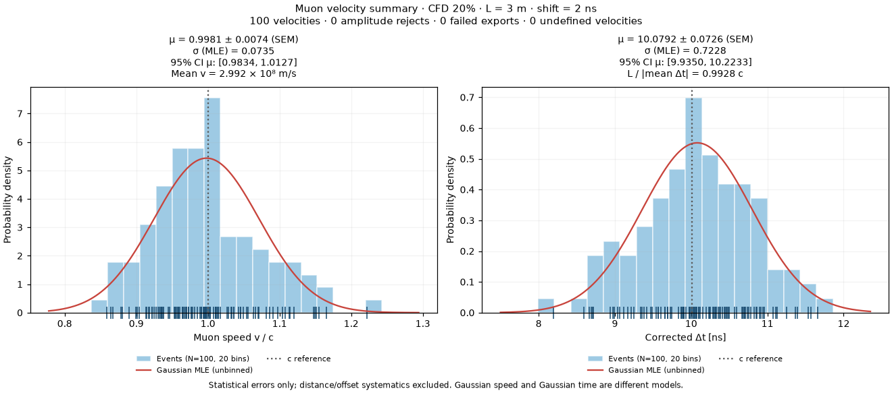
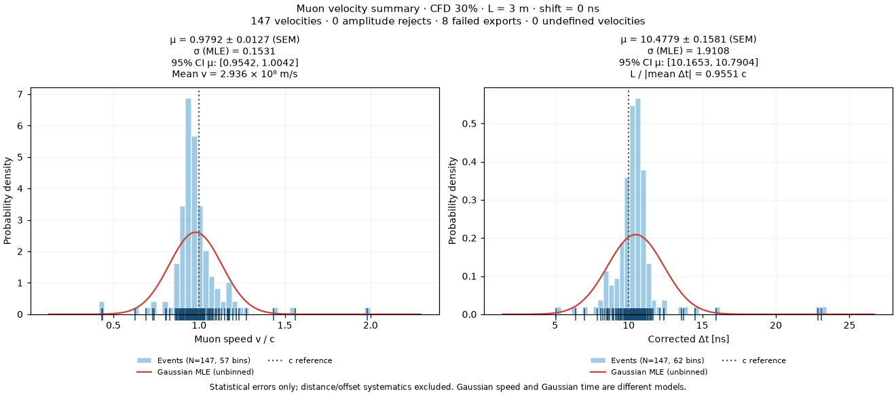
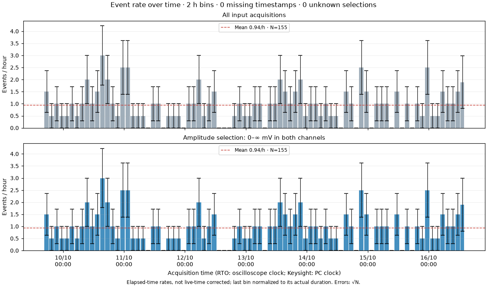

# Tempo di volo dei muoni con l'oscilloscopio Keysight DSOX1202A

Stessa misura fatta con l'RTO6 ([`../RTO6/README.md`](../RTO6/README.md)), ma
con un oscilloscopio economico (Keysight InfiniiVision DSOX1202A, 2 canali,
2 GSa/s), più vicino a quello che una scuola può avere. I due CosmicWatch sono
a **3 m** di distanza. L'acquisizione è automatica: uno script legge
l'oscilloscopio via USB per giorni e salva un file per ogni coincidenza.
Ottobre 2026.

| file | contenuto |
|---|---|
| [`acquire_coincidences.py`](acquire_coincidences.py) | acquisizione automatica via USB, LAN o bastion SSH |
| [`README_acquisition.md`](README_acquisition.md) | istruzioni dettagliate: connessione, impostazioni, file prodotti, problemi noti |
| [`make_synthetic.py`](make_synthetic.py) | genera eventi simulati nel formato Keysight, per provare l'analisi |
| [`test_acquire_coincidences.py`](test_acquire_coincidences.py) | test dell'acquisizione con un oscilloscopio simulato |
| `run_3m/`, `prova_*/`, `synthetic/` | dati e risultati (non in git) |
| [`figures/`](figures/) | figure di riepilogo usate in questo documento |

L'analisi usa [`../analysis_code/analyze_pulses.py`](../analysis_code/analyze_pulses.py),
condiviso con l'RTO6.

---

## 1. Come funziona l'acquisizione

`acquire_coincidences.py` ripete un ciclo semplice:

1. arma l'oscilloscopio in modalità *single*;
2. aspetta il trigger, cioè una coincidenza (pattern `11X`: C1 **e** C2 sopra
   10 mV);
3. legge C1 e C2 della stessa acquisizione (2000 punti a 0.5 ns, da −200 a
   +800 ns);
4. salva un file `scope_NNNNNN.csv` nel formato dell'export Keysight e una riga
   in `events.csv` con ora del PC, tempo vivo, ampiezze e campioni saturati.

Gestisce da solo le interruzioni della comunicazione USB (clear USBTMC,
riconnessione con attesa crescente, recupero dell'evento in sospeso). Le
impostazioni sono fisse nello script e scelte sugli impulsi reali: 25 mV/div
con 87.5 mV al centro, 100 ns/div.

```bash
python acquire_coincidences.py --usb -o run_3m --check     # controlla le impostazioni ed esce
python acquire_coincidences.py --usb -o test_vicini --max-events 5
caffeinate -is python acquire_coincidences.py --usb -o run_3m
```

Su Linux disattivare la sospensione automatica (vedi
[`README_acquisition.md`](README_acquisition.md)).

## 2. Analisi

```bash
python ../analysis_code/analyze_pulses.py run_3m --distance-m 3 --offset-ns <offset calibrato> \
    --fraction 0.3 --min-amplitude-mv 10 --max-amplitude-mv 130
```

Per i file del Keysight il rate nel tempo usa l'ora del PC registrata in
`events.csv`, perché il CSV dell'oscilloscopio non ha un timestamp.

### 2.1 Prova dell'analisi su eventi simulati

`make_synthetic.py` genera eventi realistici con parametri noti: impulsi con
salita di 3 ns e discesa di 40 ns, ampiezze distribuite come una Landau,
rumore di 1 mV, quantizzazione di 0.5 mV, jitter di 0.5 ns per canale.
`synthetic/` ne contiene 100 con tempo di volo 10.007 ns (3 m a v = c) e
offset 2 ns.

```bash
python make_synthetic.py                    # default: 100 eventi in synthetic/, 3 m, v = c, offset 2 ns
python ../analysis_code/analyze_pulses.py synthetic --distance-m 3 --offset-ns 2 --fraction 0.2
```



*Figura 1. Analisi dei 100 eventi simulati. **Destra:** ΔT corretto per
l'offset noto (2 ns). La media, 10.08 ± 0.07 ns, coincide con il valore vero
10.007 ns. La larghezza, 0.72 ns, è quella attesa da 0.5 ns di jitter per
canale (0.5·√2 = 0.71 ns). **Sinistra:** v/c ricostruita, 0.998 ± 0.007.
L'analisi non introduce distorsioni apprezzabili.*

## 3. Dati

| cartella | data | contenuto |
|---|---|---|
| `prova_usb/` | 09/10 | 5 coincidenze, impostazioni del pannello (prima prova USB) |
| `prova_auto/`, `prova_fissi/` | 09/10 | 3 e 2 coincidenze, impostazioni fisse dello script |
| `run_3m/` | 09/10 16:12 – 16/10 15:16 | **155 coincidenze in 165.6 h**, rivelatori a 3 m |

In `run_3m`: 155 trigger, nessuna riconnessione, tempo vivo 167 h. 147 eventi
sono analizzati con successo. Gli 8 scartati hanno l'impulso nella regione
usata per la baseline (5), nessun attraversamento della soglia di frazione (2)
o rapporto segnale/rumore troppo basso (1).

## 4. Risultati

### 4.1 Tempo di volo a 3 m



*Figura 2. 147 eventi a 3 m, constant fraction al 30%, **offset non
sottratto** (shift = 0). **Destra:** ΔT = t(C2) − t(C1); la linea punteggiata è
3 m / c = 10.01 ns. **Sinistra:** v/c evento per evento. La gaussiana in rosso è
stimata su tutti gli eventi, incluse le code. Gli errori sono solo statistici.*

| | ΔT [ns] | v/c (da ΔT medio, offset = 0) |
|---|---|---|
| tutti i 147 eventi | 10.48 ± 0.16 (σ = 1.91) | 0.955 ± 0.015 |
| 143 eventi entro ±5 ns dal picco | 10.30 ± 0.09 (σ = 1.06) | 0.972 ± 0.008 |
| atteso per v = c | 10.01 | 1 |

- **Picco al posto giusto:** a 10.3 ns, dove ci si aspetta un oggetto che
  viaggia a c. Con un oscilloscopio da scuola si vede chiaramente il tempo di
  volo dei muoni.
- **Offset non calibrato.** Questa analisi usa offset zero, cioè assume cavi
  di uguale lunghezza e rivelatori identici. Lo scarto di 0.3 ns rispetto
  all'atteso è dello stesso ordine degli offset tipici, quindi **non è una
  misura della velocità**. Serve una calibrazione con i rivelatori sovrapposti,
  con questo oscilloscopio e questi cavi: il valore dell'RTO6 non è
  trasferibile.
- **Risoluzione:** σ = 1.06 ns sulla differenza, contro 0.85 ns con l'RTO6 a
  1.87 m. È peggiore per l'ingresso a 1 MΩ e la quantizzazione di ~1 mV, ma
  resta molto più piccola del tempo di volo.

### 4.2 Rate e accidentali



*Figura 3. Coincidenze per ora in bin di 2 ore, 9–16 ottobre. Le due righe
sono identiche perché qui non ci sono tagli in ampiezza. Media 0.94/h, senza
andamenti evidenti nel tempo. Le barre sono √N.*

- **Atteso per un singolo muone** che attraversa due scintillatori di 25 cm² a
  3 m in verticale: I·A²/d² ≈ 70 × (0.0025)² / 9 m⁻² s⁻¹ ≈ **0.18/h**.
- **Osservato:** **0.94 ± 0.08/h**, circa 5 volte di più.
- **Accidentali:** il trigger richiede impulsi sovrapposti, entro ~200 ns. Le
  coincidenze casuali avrebbero ΔT sparsi uniformemente su centinaia di ns,
  mentre solo 4 eventi su 147 sono lontani dal picco. Il fondo casuale è quindi
  ≲ 3%, e non spiega l'eccesso.
- **Interpretazione più probabile:** coppie di particelle dello stesso sciame
  atmosferico. Nella misura con 7 CosmicWatch sul tavolo
  ([`../Data/showers_analysis/ANALISI_SCIAMI.md`](../Data/showers_analysis/ANALISI_SCIAMI.md))
  queste coppie valgono ~0.5/h per coppia di rivelatori a 1.5–2.3 m. Sommate ai
  muoni singoli si arriva all'ordine di grandezza osservato. Per rivelatori
  impilati anche queste coppie danno ΔT ≈ d·cosθ/c, cioè un picco vicino a
  quello dei muoni singoli: il tempo di volo da solo non le distingue.

## 5. Cosa migliorare

1. **Calibrare l'offset** con i rivelatori sovrapposti, all'inizio e alla
   fine, poi rianalizzare `run_3m` con quel valore.
2. **Più spazio prima del trigger** (`--delay-ns`): in 5 eventi l'impulso è
   finito nella regione della baseline.
3. **Separare muoni singoli e sciami** con un terzo rivelatore a fianco, fuori
   dalla linea verticale: se scatta anche lui, la coincidenza viene da uno
   sciame.
4. **Provare sullo strumento** le funzioni ancora non verificate:
   impostazione del trigger da script, riconnessioni automatiche, modalità SSH.
