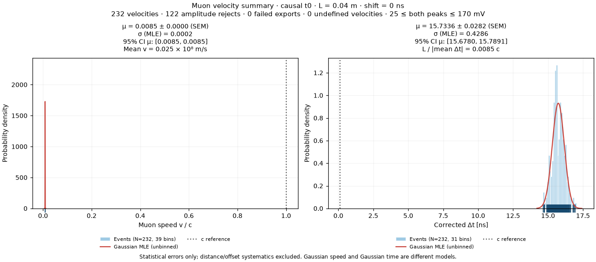
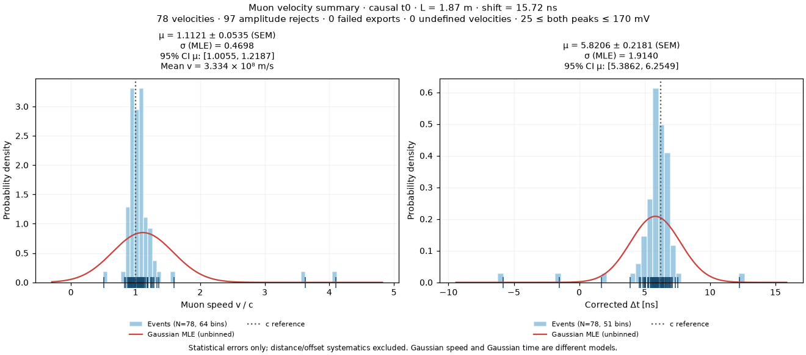
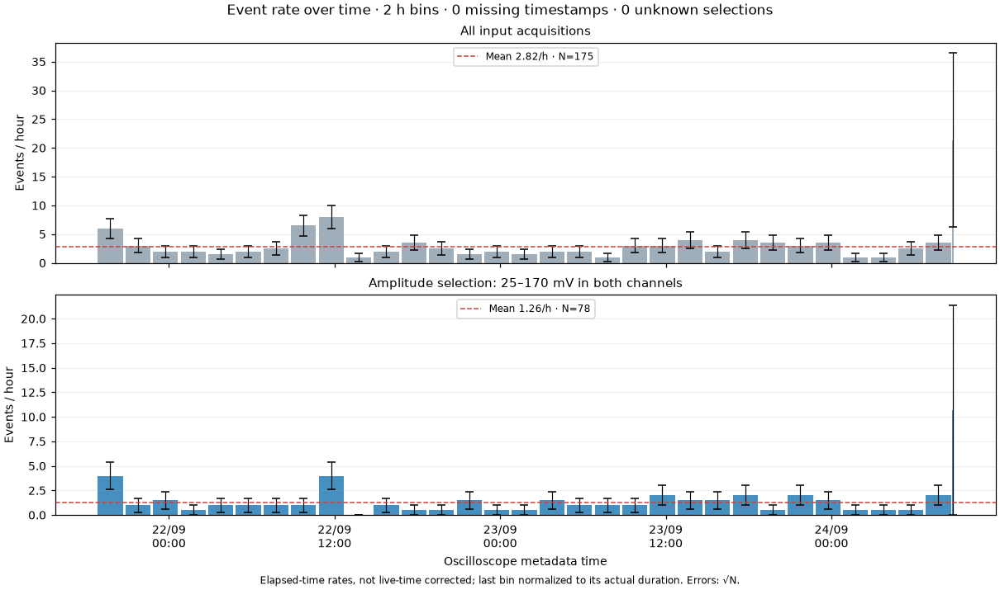

# Tempo di volo dei muoni con l'oscilloscopio R&S RTO6

Misura del tempo che un muone impiega a percorrere la distanza fra due
CosmicWatch impilati, leggendo direttamente gli impulsi dei SiPM con un
oscilloscopio veloce (Rohde & Schwarz RTO6, 2 canali, campionamento 0.5 ns).
Settembre 2026.

| file | contenuto |
|---|---|
| [`copyFileToPc.py`](copyFileToPc.py) | copia sul PC gli export salvati sull'oscilloscopio, anche attraverso il bastion SSH |
| [`README_copy.md`](README_copy.md) | istruzioni dettagliate per la copia (tunnel, filtri per data, problemi noti) |
| [`README_timing.md`](README_timing.md) | modello, opzioni e verifiche dell'analisi delle forme d'onda |
| [`test_copyFileToPc.py`](test_copyFileToPc.py) | test della copia |
| `0ps/`, `16ps/` | dati e risultati (non in git) |
| [`figures/`](figures/) | figure di riepilogo usate in questo documento |

L'analisi usa [`../analysis_code/analyze_pulses.py`](../analysis_code/analyze_pulses.py),
condiviso con il Keysight.

---

## 1. L'idea

Un muone cosmico viaggia praticamente alla velocità della luce: per percorrere
1.87 m impiega 1.87 m / c = **6.24 ns**. Se due rivelatori sono uno sopra
l'altro, il muone che li attraversa entrambi produce due impulsi separati da
questo tempo. Per misurarlo servono:

- **un oscilloscopio veloce**: i fronti degli impulsi durano ~10 ns e vanno
  campionati finemente;
- **un buon stimatore del tempo di arrivo**: constant fraction o fit della
  forma dell'impulso, non la semplice soglia, che dipende dall'ampiezza;
- **una calibrazione dell'offset**: cavi di lunghezza diversa ed elettronica
  aggiungono un ritardo fisso fra i canali. Qui il cavo di C2 è più lungo di
  circa 16 ns, più del tempo di volo stesso. L'offset si misura mettendo i
  rivelatori a contatto, dove il tempo di volo è trascurabile.

## 2. Procedura

1. **Setup:** i due CosmicWatch, uno sopra l'altro, con le uscite analogiche
   dei SiPM su C1 (sopra) e C2 (sotto). L'oscilloscopio usa un trigger di
   coincidenza fra i due canali e salva ogni evento come export `RefCurve_*.csv`
   più `RefCurve_*.Wfm.csv`.
2. **Copia dei dati sul PC** (dalla cartella `RTO6`, venv attivo):
   ```bash
   python copyFileToPc.py --ssh-bastion <utente>@<bastion> --instrument-host <IP-oscilloscopio> \
       -f 'RefCurve_*' --since '2026-09-24 14:15' -o 0ps/
   ```
   Dettagli in [`README_copy.md`](README_copy.md).
3. **Calibrazione:** stessa analisi con i rivelatori a contatto e offset zero.
   Il ΔT medio misurato è l'offset da usare dopo.
   ```bash
   python ../analysis_code/analyze_pulses.py '0ps/RefCurve_*' --offset-ns 0 --distance-m 0.04 \
       --min-amplitude-mv 25 --max-amplitude-mv 170 --fraction 0.3 --summary-method causal \
       --output-dir 0ps/timing_results
   ```
4. **Tempo di volo**, con l'offset della calibrazione:
   ```bash
   python ../analysis_code/analyze_pulses.py '16ps/RefCurve_2026-09-2*' --offset-ns 15.72 --distance-m 1.87 \
       --min-amplitude-mv 25 --max-amplitude-mv 170 --fraction 0.3 --summary-method causal \
       --output-dir 16ps/timing_results
   ```

**Tagli in ampiezza (25–170 mV su entrambi i canali).** Sotto 25 mV il fronte è
troppo vicino al rumore. Sopra 170 mV l'impulso può essere saturato.
**Stimatore:** t0 dal fit causale della forma (`--summary-method causal`). Il
modello è descritto in [`README_timing.md`](README_timing.md).

## 3. Dati

| cartella | date | distanza | acquisizioni | dopo i tagli | durata |
|---|---|---|---|---|---|
| `0ps/` | 24/09, 15:07–15:36 | 4 cm (rivelatori a contatto) | 354 | 232 | 0.49 h |
| `16ps/` | 21/09 18:45 – 24/09 08:51 | 1.87 m | 175 | 78 | 62.1 h |

In entrambe le prese i rivelatori sono allineati sulla verticale. **Nomi delle
cartelle:** la loro logica originale non è stata annotata. Dai dati, `0ps`
corrisponde ai rivelatori a contatto (calibrazione) e `16ps` alla presa a
distanza; "16" richiama probabilmente il ritardo di ~16 ns del cavo di C2, che
però è presente in entrambe le prese (il ΔT misurato a contatto è 15.7 ns).
Nelle prossime edizioni conviene dare nomi espliciti, per esempio
`calibrazione_4cm/` e `tof_187cm/`, e annotare cavi e distanze in un file di
testo accanto ai dati.

## 4. Risultati

### 4.1 Calibrazione dell'offset (rivelatori a contatto)



*Figura 1. Calibrazione con i rivelatori a contatto (4 cm), 232 eventi con
entrambi i picchi fra 25 e 170 mV, offset zero. **Destra:** distribuzione di
ΔT = t(C2) − t(C1) con la gaussiana stimata sugli eventi. Il valore medio,
15.73 ns, è il ritardo strumentale fra i canali (cavo più lungo su C2 più
eventuali differenze fra i rivelatori). **Sinistra:** la "velocità" calcolata
con L = 4 cm non ha significato fisico: è solo un effetto dell'offset non
sottratto.*

- **Offset:** ΔT₀ = **15.73 ± 0.03 ns**, compatibile con i ~16 ns attesi dal
  cavo.
- **Risoluzione:** σ = **0.43 ns** sulla differenza di due tempi, cioè circa
  0.3 ns per rivelatore. È la precisione con cui un CosmicWatch letto
  all'oscilloscopio dà il tempo di passaggio di un muone.
- **Rate:** 470 eventi/h dopo i tagli. Con i rivelatori a contatto l'angolo
  solido è grande.

### 4.2 Tempo di volo a 1.87 m



*Figura 2. Tempo di volo con i rivelatori a 1.87 m, 78 eventi dopo i tagli,
offset 15.72 ns sottratto. **Destra:** ΔT corretto; la linea punteggiata è
1.87 m / c = 6.24 ns. **Sinistra:** v/c evento per evento. La gaussiana (in
rosso) è stimata su tutti gli eventi ed è allargata da 3 eventi lontani dal
picco (a −6, −2 e +12 ns). Gli errori sono solo statistici: offset e distanza
non sono inclusi.*

| | ΔT corretto [ns] | v/c (da ΔT medio) |
|---|---|---|
| tutti i 78 eventi | 5.82 ± 0.22 (σ = 1.91) | 1.07 ± 0.04 |
| 75 eventi entro ±5 ns dal picco | 5.99 ± 0.10 (σ = 0.85) | 1.04 ± 0.02 |
| atteso per v = c | 6.24 | 1 |

**La scala dei tempi è giusta:** il picco è a 6 ns, dove ci si aspetta un
oggetto che viaggia a c. Il valore misurato è ~0.25 ns (circa 4%) più corto
dell'atteso, a ~2.5σ statistiche. Possibili cause sistematiche:

- **Offset:** misurato su un'altra presa e con altre ampiezze. Gli eventi a
  1.87 m hanno ampiezze in media minori, e un effetto di walk residuo di pochi
  decimi di ns basta a spiegare la differenza.
- **Distanza:** 1.87 m è la separazione nominale. 4 cm di errore corrispondono
  al 2%.
- **Coincidenze da sciame** (sez. 4.3): due particelle diverse dello stesso
  sciame arrivano con ΔT = d·cosθ/c, più corto di d/c se lo sciame è inclinato.

La risoluzione (σ = 0.85 ns contro 0.43 ns della calibrazione) è peggiore,
come atteso per impulsi più piccoli.

### 4.3 Rate delle coincidenze



*Figura 3. Rate di acquisizione nel tempo, in bin di 2 ore. **Sopra:** tutte le
acquisizioni (2.8/h in media). **Sotto:** quelle con entrambi i picchi fra 25 e
170 mV (1.26/h). Il tempo è quello dell'orologio dell'oscilloscopio. Il rate è
calcolato sul tempo trascorso, senza correzione per il tempo morto.*

- **Atteso per un singolo muone** che attraversa due scintillatori di 25 cm²
  a 1.87 m in verticale: I·A²/d² ≈ 70 m⁻²s⁻¹sr⁻¹ × (0.0025 m²)² / (1.87 m)²
  ≈ **0.45/h**.
- **Osservato:** 1.26/h dopo i tagli, cioè ~3 volte di più.
- **Accidentali:** il trigger richiede impulsi sovrapposti entro ~200 ns.
  Coincidenze casuali darebbero ΔT sparsi uniformemente su ±200 ns, mentre solo
  3 eventi su 78 cadono fuori dal picco. Il fondo casuale è quindi ≲ 4%.

L'eccesso è compatibile con quanto trovato con 7 CosmicWatch sul tavolo
([`../Data/showers_analysis/ANALISI_SCIAMI.md`](../Data/showers_analysis/ANALISI_SCIAMI.md)):
a 1.5–2.3 m di distanza, coppie di particelle dello stesso sciame danno
~0.5/h per coppia di rivelatori. Sommate ai muoni singoli si arriva a ~1/h. Le
soglie dei due setup sono diverse, quindi è un confronto di ordine di
grandezza.

## 5. Cosa migliorare

1. **Calibrare l'offset subito prima e subito dopo** la presa a distanza, con
   gli stessi cavi e tagli in ampiezza simili.
2. **Scambiare i rivelatori sui canali** a metà presa, per separare il
   ritardo dei cavi da quello dei rivelatori.
3. **Più distanza o più statistica:** con 3 m il tempo di volo sale a 10 ns e
   lo stesso errore sistematico pesa meno (vedi
   [`../Keysight-1000X/README.md`](../Keysight-1000X/README.md)).
4. **Ottimizzare la scala verticale di C2:** nel primo evento analizzato il
   picco occupava solo ~8 livelli dell'ADC.
